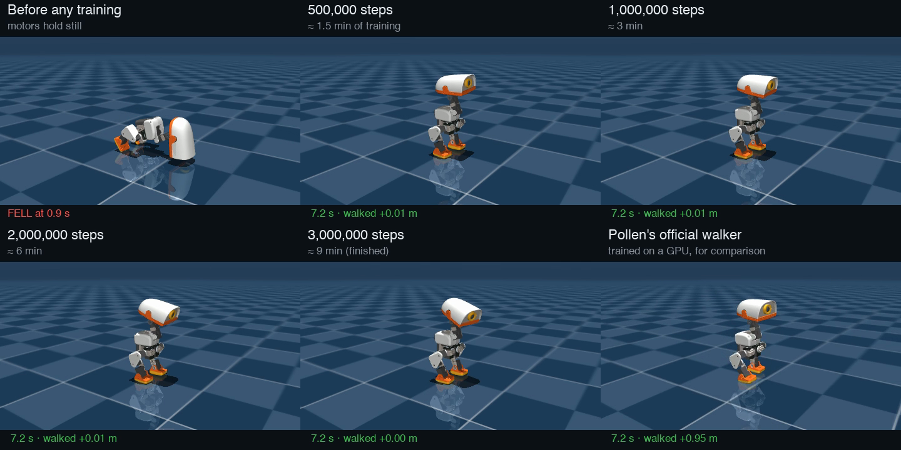
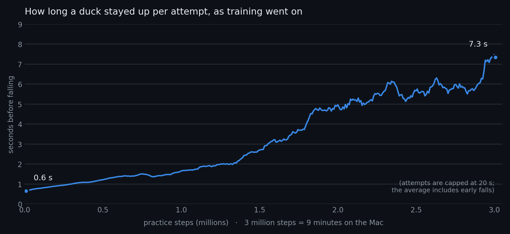

# How a robot duck learns to walk

*What "I ran the lab's starter training, 3 million practice steps, 9 minutes" actually means. Written
2026-11-03 from my own first training run on my MacBook Pro. Every number here was measured from
that run's logs, not taken from a brochure.*

---

## The short version (the one to tell people)

> Nobody programs the duck to walk. Its "brain" is a few hundred thousand numbers that start out
> random. A simulator lets 32 virtual ducks practise at once, much faster than real time, and every
> fiftieth of a second each duck gets a score: points for staying upright and doing what it was
> asked, deductions for flailing. After each short burst of practice, the computer nudges the
> numbers towards whatever scored better than expected. Repeat a few hundred times and behaviour
> appears that nobody wrote.
>
> My first run: **9 minutes on a laptop = 16.7 hours of duck practice, about 29,000 attempts.** At
> the start a duck fell over within 0.6 seconds. By the end it stayed up for the whole test.
>
> The twist: it learned to **stand very well**, not to walk. Standing still turned out to be the
> easiest way to score points. Getting the score right is the real craft.

---

## 1. The duck's brain is a "policy"

| | |
|---|---|
| What it is | A small neural network: a function that takes numbers in and gives numbers out |
| How often it runs | **50 times a second** |
| Numbers in (61) | how the trunk is rotating and tilting, where each of the 14 joints is and how fast it's moving, what it did last time, and the **command**: how fast to walk, turn, and where to point the head |
| Numbers out (14) | a target angle for each of the 14 motors |
| Size | 61 → 512 → 256 → 128 → 14: four layers, **197,896 numbers** ("weights"), a 775 KB file (`policy.onnx`) |

The network's *shape* is fixed. Training only changes those 197,896 numbers. Before training they're
random, so the duck twitches and collapses. After training, the same arithmetic happens to produce
balance.

An analogy for Swift people: it's a pure function `(SensorReading) -> MotorTargets` with 198,000
magic constants, and training is a search for good constants.

---

## 2. What a "step" is

**One step = 1/50th of a second of duck life.** Each step:

1. The simulator reports where the duck's body and joints are.
2. The brain turns that into 14 motor targets.
3. The physics engine (MuJoCo) moves the world forward 0.02 seconds: motors push, gravity pulls,
   feet hit the floor.
4. The duck gets a score for that moment (section 4).

The simulated motors are realistic, not idealised: they respond with delay, limited strength and
friction, modelled from measurements of the real Dynamixel servos (Pollen's "BAM" motor models).

---

## 3. What "3 million steps in 9 minutes" adds up to

| | My run (`first-gait`) |
|---|---|
| Total steps | 3,006,464 |
| Duck time that represents | 3,006,464 × 0.02 s = **60,129 s = 16.7 hours** |
| Wall-clock time | 522 s = **8.7 minutes** |
| Speed-up | **≈ 115 × faster than real time** |
| Ducks practising at once | **32** (each one lived about 31 minutes) |
| Attempts | **≈ 29,000.** An attempt ends when the duck falls, or after 20 seconds |
| Learning rounds | **367** (section 5) |
| Computer | MacBook Pro, CPU only. No NVIDIA graphics card |

Why so fast? There are no graphics: the ducks aren't drawn while they practise, only calculated. And
32 of them run side by side on the Mac's processor cores.

For scale, Pollen's official walker was trained on an NVIDIA GPU with **4,096 ducks at once**. A
typical run is several hundred to a few thousand learning rounds of 4,096 ducks × 24 steps each:
roughly **75 to 400 million steps**, 25 to 130 times my 3 million.

---

## 4. How it knows what "good" is: the reward

Every step, each duck earns points from eight rules (the **reward terms**). These are the exact
rules my run used:

| Rule | What earns points | Start of training | End |
|---|---|---|---|
| `track_lin_vel` | moving at the commanded speed and direction | 20 | 420 |
| `track_ang_vel` | turning at the commanded rate (and not wobbling) | 0.8 | 117 |
| `upright` | trunk level, not tipping | 21 | 690 |
| `pose` | joints near a natural standing posture | 11 | 294 |
| `head_pose` | head where it was told to look | 48 | 608 |
| `feet_air_time` | each foot spending 0.125–0.3 s in the air: real steps, not shuffles | 10 | 14 |
| `action_rate_penalty` | **deduction** for jerky changes between one step and the next | −83 | **−1,061** |
| `ang_vel_xy_penalty` | **deduction** for rocking side to side or front to back | −18 | −20 |
| **Total per attempt (average)** | | **10** | **885** |

(The numbers are each rule's points added up over a whole attempt, averaged across attempts at that
point in training. They grow partly because attempts get longer: more time alive means more steps
to earn points in.)

A few things worth noticing:
- Most of the rules use partial credit. Being *close* to the commanded speed still pays something,
  so a duck standing still while asked to walk slowly still collects some `track_lin_vel` points.
- `feet_air_time` barely moved, from 10 to 14. The ducks hardly ever lifted a foot. That's the clue
  for section 8.
- Falling has no explicit penalty. Falling ends the attempt, and a duck on the floor collects
  nothing more, so staying up is worth every point you'd have earned afterwards.

---

## 5. The learning loop (PPO)

The algorithm is **PPO**, Proximal Policy Optimization (OpenAI, 2017). It's the standard choice for
robot locomotion. One learning round:

1. **Practise.** All 32 ducks run for 256 steps (about 5 seconds each): 8,192 moments of experience.
   The brain adds a little random wiggle to its outputs so it tries variations. Without that wiggle
   it could never discover anything new.
2. **Judge.** A second network, the **critic**, has been learning to predict "from this situation,
   how many points do I usually get from here on?" For each moment, compare what actually happened
   with the critic's prediction. Better than expected means that action was a good idea; worse
   means it wasn't. That difference is called the **advantage**.
3. **Nudge.** Adjust the 197,896 numbers so good-idea actions become a bit more likely and bad ones
   a bit less. Only *a bit*: PPO caps how far one round can move the brain ("proximal" = stay
   close). Big jumps tend to wreck what it has already learned. It goes over the 8,192 moments 5
   times, in batches.
4. Repeat. My run did this **367 times**.

As training goes on, the random wiggle shrinks: the brain gets more confident and explores less.

---

## 6. Watch it learn

The same duck brain at five moments in my training run, plus Pollen's official walker for
comparison. Every tile gets the same instruction: **walk forward at 0.3 m/s**. Each clip is 8
seconds, and the caption at the bottom says how far the duck has moved.

<video controls loop muted playsinline src="media/first-gait-learning-stages.mp4"></video>

*([video file](media/first-gait-learning-stages.mp4), if the player above doesn't show)*

| Stage | What happens |
|---|---|
| Before any training (motors just hold still) | collapses at **0.9 s** |
| 500,000 steps (≈ 1.5 min of training) | stays up the full 8 s, moves 1 cm |
| 1,000,000 steps (≈ 3 min) | stays up, 1 cm |
| 2,000,000 steps (≈ 6 min) | stays up, 1 cm |
| 3,000,000 steps (≈ 9 min, finished) | stays up, 0 cm |
| **Pollen's official walker** | stays up, **walks 95 cm** |

And the learning curve from the run's own log: how long a duck lasted per attempt as training went on.

The jump around 1.8 million steps is the brain "getting" balance. During training the attempts are
harder than in the clips: random pushes, random commands, sensor noise (section 9). That's why the
average stays below the 20-second cap even though the test clips never fall.

---

## 7. How I know it stands rather than walks

- The lab's test battery (`eval-walk`) said **0 falls in 20 attempts**, which sounds great.
- It also said speed tracking was off by **0.23 m/s on average**. That's roughly the size of the
  commands themselves, which means "basically ignoring them".
- So I measured directly: asked for 0.15, 0.3 and 0.5 m/s, the trained duck moved **0.00 m** every
  time. Pollen's walker, through the same test, moved 1.06 m at 0.3 and 1.70 m at 0.5.

Lesson I'm keeping: **watch or measure the behaviour, don't trust a single score.**

---

## 8. Why it learned to stand: the most important idea in all of this

The duck did exactly what the score rewarded. It just found a strategy I didn't intend:

- **Standing pays reliably.** `upright`, `pose` and `head_pose` pay every step a duck is level and
  still. Those three added up to ~1,600 points at the end.
- **Walking is risky.** Lifting a foot risks a fall, and a fall forfeits every future point.
- **Moving costs.** `action_rate_penalty` deducts for jerky movement. At the end it was the single
  largest term, at −1,061. Standing still is the cheapest way to keep that small.
- **Partial credit.** Standing still while asked to walk slowly still earns some speed-tracking
  points.

So "stand perfectly and ignore the speed command" is a **local optimum**: a solution that's good
enough, where any small change (taking a wobbly first step) scores worse before it would score
better. With limited practice, PPO's small careful nudges don't get it over that hump.

This has a name, **reward hacking** (or "specification gaming"): the learner satisfies the letter of
the reward and not its spirit. It's the central skill of this field. The algorithm is off the shelf.
The craft is designing a score that makes the behaviour you want the easiest way to win. That's what
the Microduck lets me practise.

The usual levers, which I can now try:
- **More practice**: the official walker saw 25–130× more.
- **Pay for stepping more, or penalise jerkiness less early on**. The lab already eases in the
  jerkiness penalty in stages for this reason.
- **A curriculum**: teach standing first, then slow walking, then faster.

---

## 9. Getting from simulation to the real duck

A brain trained in a perfect simulator often fails on a real robot: the **sim-to-real gap**. Two
defences, both switched on in my run:
- **Realistic motors.** BAM models of the real servos, so the simulated motors are as weak, slow and
  sticky as the real ones.
- **Domain randomisation.** Every attempt varies the duck's mass (±5%), the motor friction and the
  motor delay, adds sensor noise, and **shoves the duck** (a push of up to 0.3 m/s every 3–6
  seconds). A brain that copes with all of those variations is more
  likely to cope with the one real duck.

The finished brain is exported as an ONNX file. The real duck runs that exact file 50 times a second.
In the simulator on my Mac, the same file goes into the real duck software (`scripts/duck-sim`).

---

## 10. Ways to explain it to someone

- **"Warmer, colder."** Like training a dog, if you could only say "good" or "bad" fifty times a
  second, and the dog had 29,000 tries.
- **A video game high score.** The duck is a player who knows nothing except that some moves raise
  the score. It plays 16 hours of "don't fall over" in 9 minutes.
- **A toddler, minus the bruises.** Practice in a virtual world where falling costs nothing, then
  bring the skill into the real one.
- **The genie problem.** You get exactly what you ask for. Ask for "upright and calm" and you get
  a duck that won't move.

---

## 11. What to try next

1. **A longer run.** The same command with more steps, e.g. `--steps 20_000_000` (roughly an hour on
   this Mac). Does it start walking? I don't know yet, and that's the experiment.
2. **Watch training live.** microduck-lab has a browser viewer with a "teach" panel. It shows ducks
   improving every ~15 seconds as new snapshots load, with sliders for the reward terms:
   `uv run duck-lab runs/first-gait`, then `npm run dev` in `~/microduck-lab/duck-viewer`.
   *Not tried yet.*
3. **Film any run** the way I made the video above (script kept in this repo's notes; ask Claude).

---

## Glossary

| Word | Meaning |
|---|---|
| **Policy** | The duck's brain: sensor numbers in, motor targets out |
| **Weights** | The numbers inside the policy that training adjusts |
| **Step** | One 1/50 s tick: look, decide, physics moves on |
| **Episode / attempt** | One try, from reset until falling or a 20 s timeout |
| **Reward** | The score per step; the only thing the duck "wants" |
| **PPO** | The learning algorithm: practise, judge, nudge a little, repeat |
| **Critic** | A helper network that predicts expected future points |
| **Advantage** | How much better or worse an action went than the critic predicted |
| **Exploration** | The random wiggle that lets the brain discover new moves |
| **Local optimum** | Good-enough strategy where small changes only make things worse |
| **Reward hacking** | Winning the score without doing what you meant |
| **Domain randomisation** | Varying the simulation so the brain copes with the real world |
| **Sim-to-real gap** | Simulation and reality differ; a brain must survive both |
| **ONNX** | The portable file format the brain is saved in (like a Core ML model) |
| **MuJoCo** | The physics engine that simulates the duck |
| **BAM** | Pollen's measured models of the real servo motors |
